# Program head

Shannon Briggs, head of the TCU CEAA Scholarship. A head can do everything
[program staff](../program-staff/README.md) can. This page shows what only a head does: approve payouts and reports,
change the program's settings, and read its audit log. [Back to all roles](../README.md)

## 1. Dashboard

The same dashboard as staff. Here **Needs attention** lists payouts waiting for a head and approved payouts ready
to release.

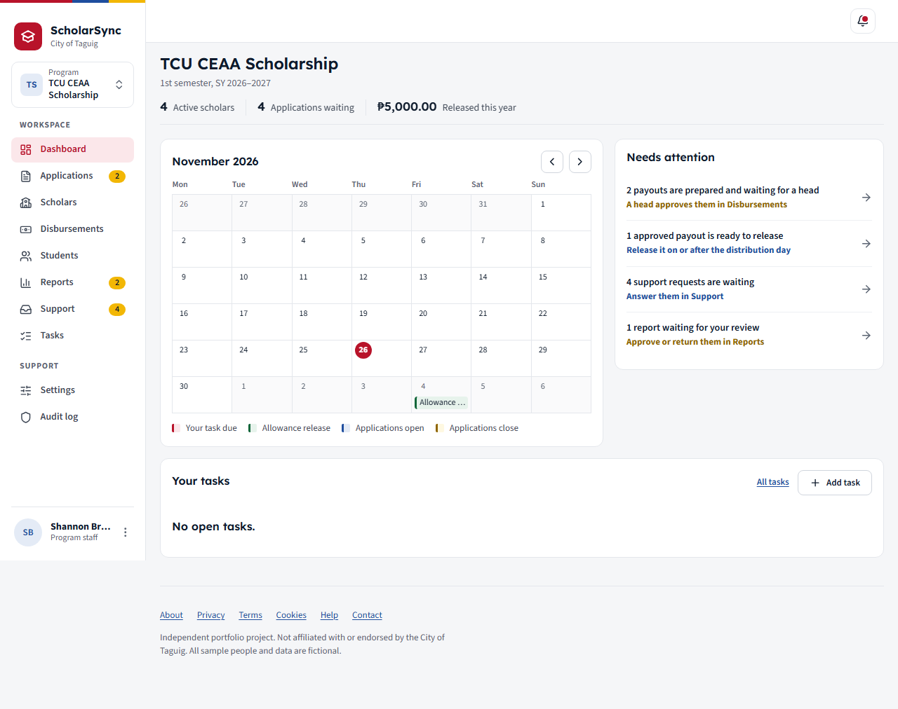

## Approving payouts

### 2. Disbursements

The 4 December 2026 distribution day has two prepared payouts waiting.

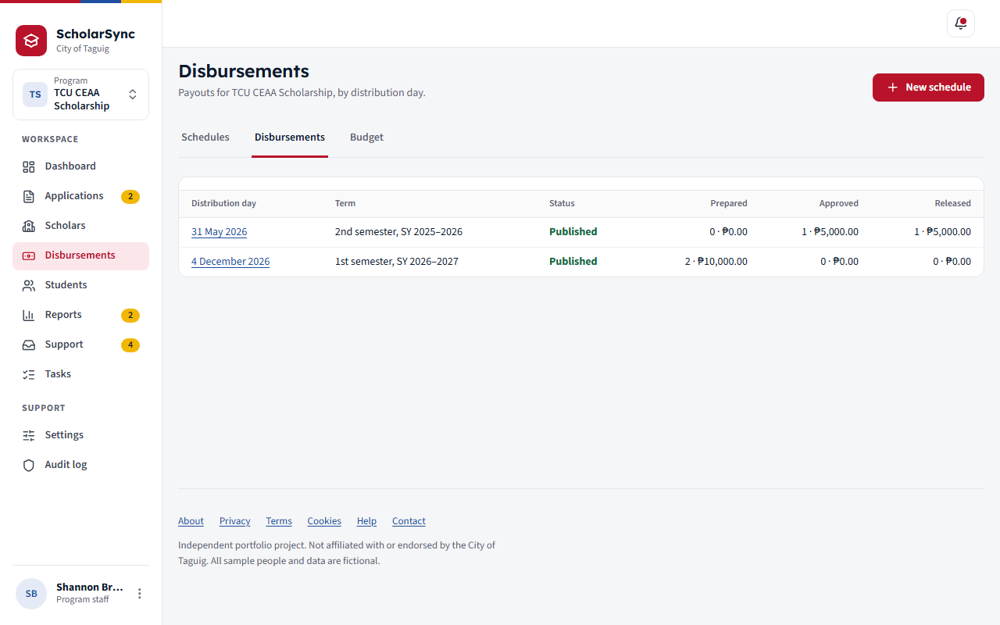

### 3. Approve and release

A head approves prepared payouts (one by one or all at once) and then releases them. Releasing asks for the
password again.

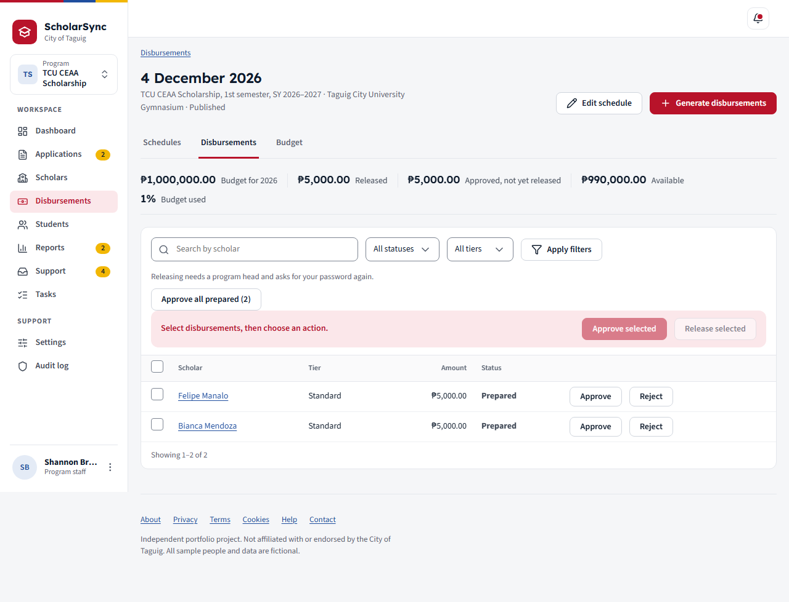

## Approving reports

### 4. Reports

**With the head** counts reports that staff wrote and the head hasn't reviewed yet.

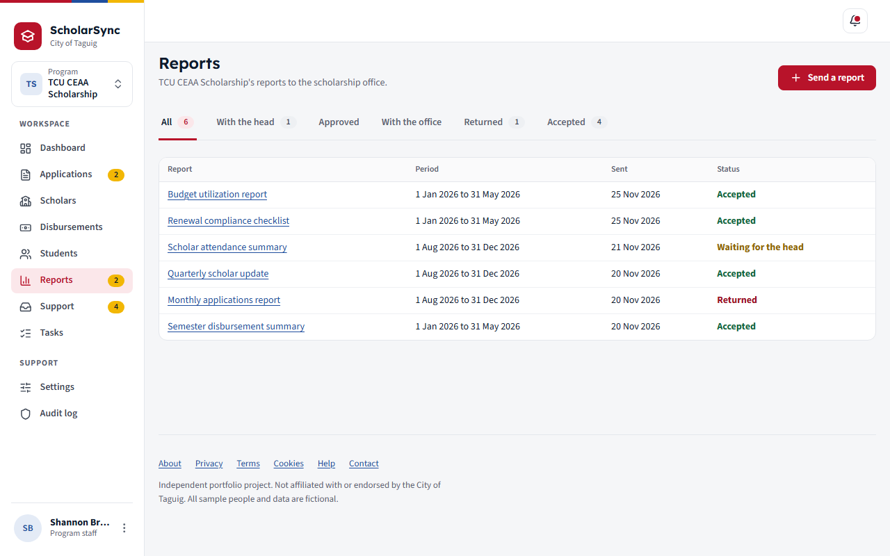

### 5. Review a report

The head approves the report, which sends it on to the scholarship office, or returns it to the writer with a note.

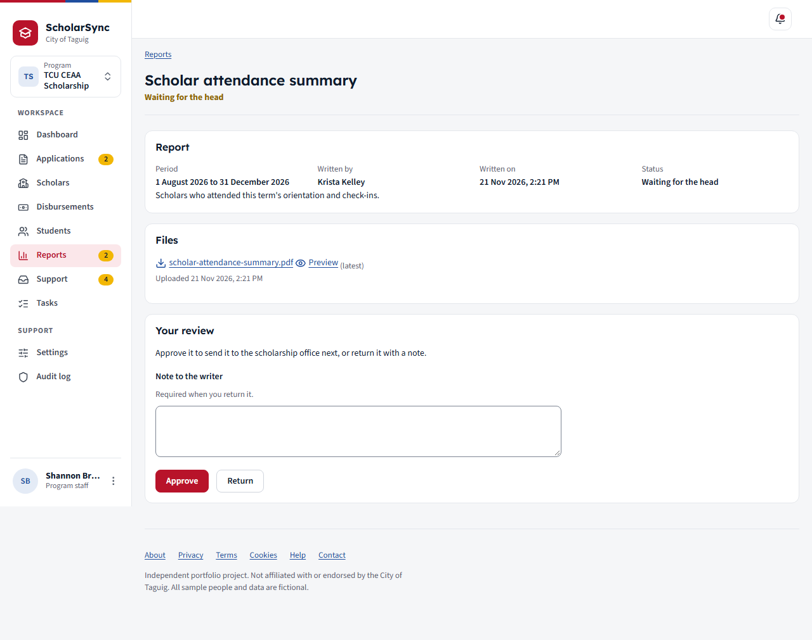

## Program settings

### 6. Rules

The application window and the eligibility rules: lowest GWA, units, years living in Taguig, voter registration,
and the school types and schools allowed.

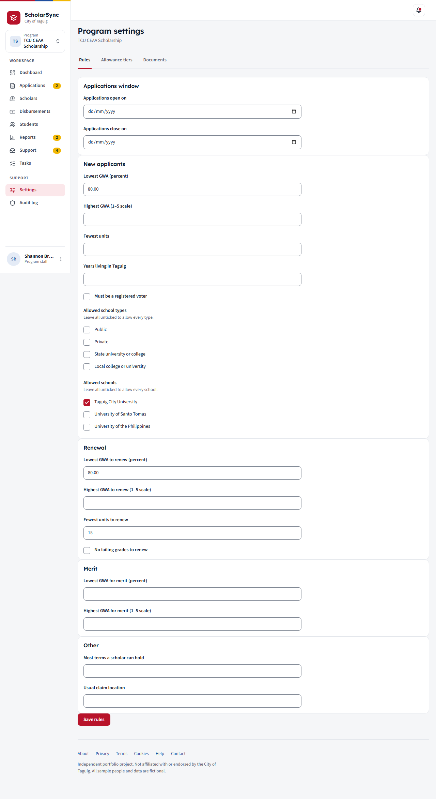

### 7. Allowance tiers

Each tier's base and merit amount from a given term, including changes scheduled for later terms. Changes ask
for the password. Records already made keep their amounts.

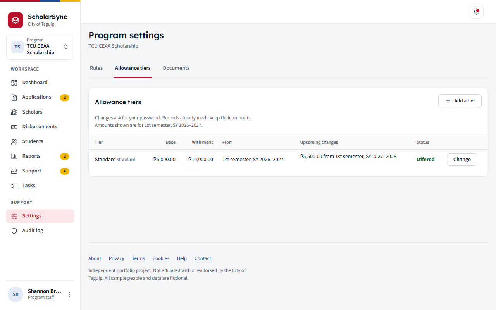

### 8. Required documents

What new applicants and renewals must upload, with the allowed file types and size.

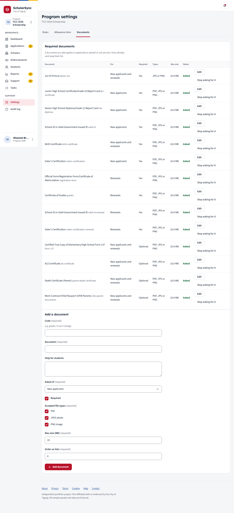

### 9. Set the budget

The program's budget for a fiscal year. Saving asks for the password.

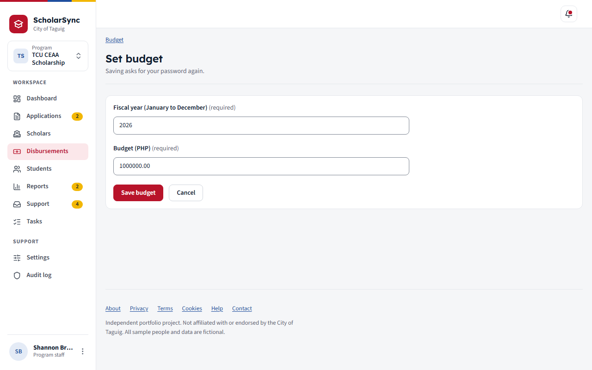

### 10. New distribution schedule

A distribution day, its term, where scholars claim, and notes for them.

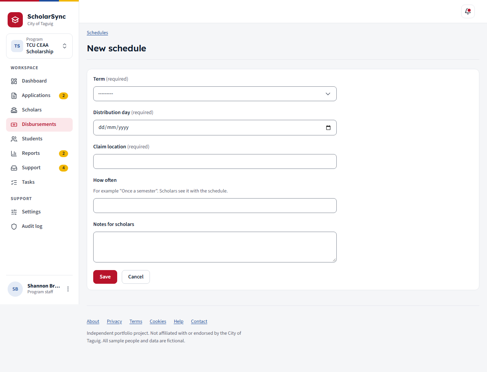

## 11. Audit log

Every change made in this program, who made it and when, filterable by kind and date.

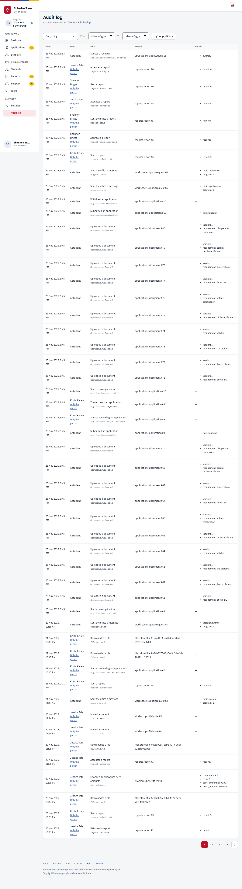
