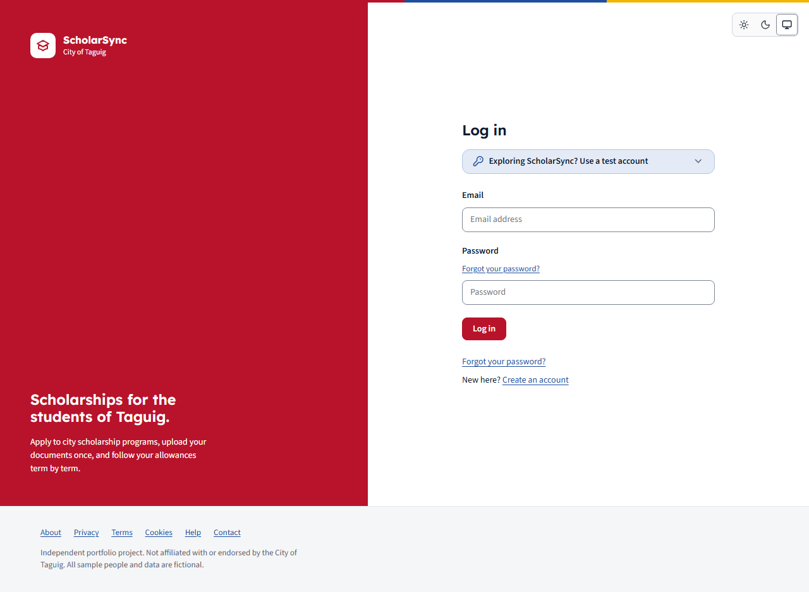
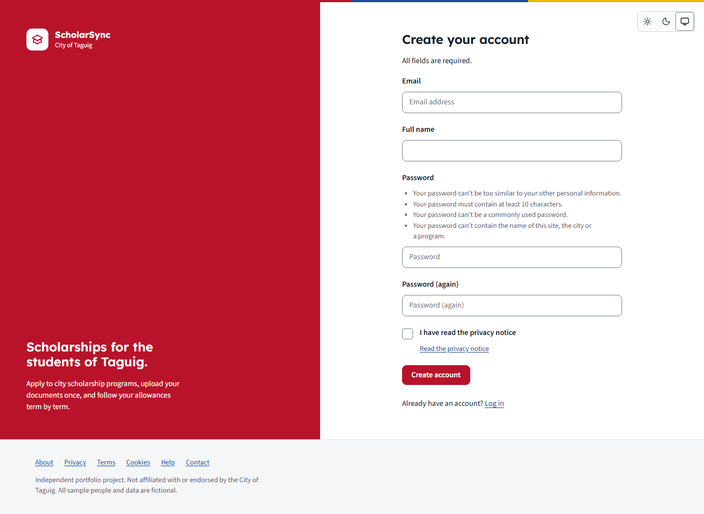
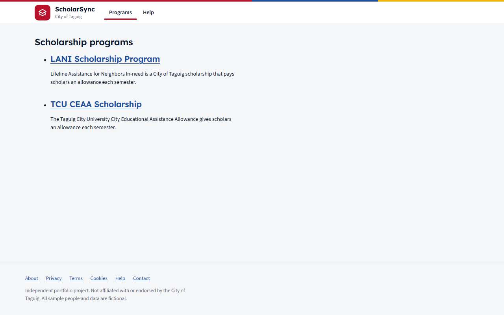
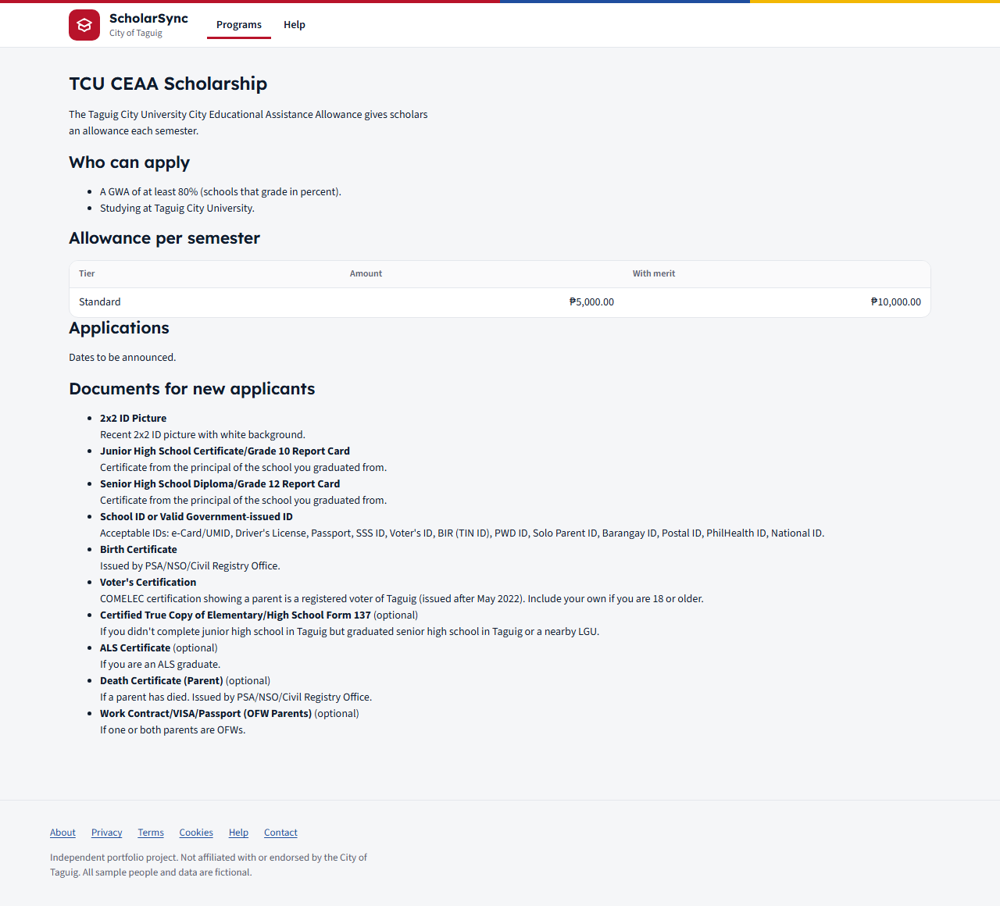
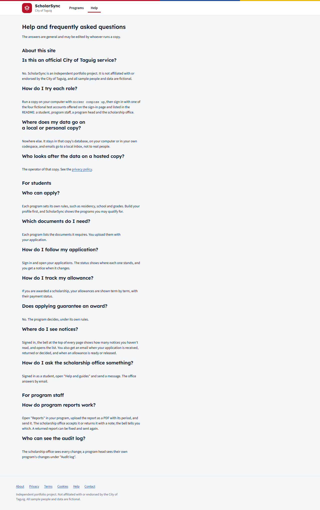
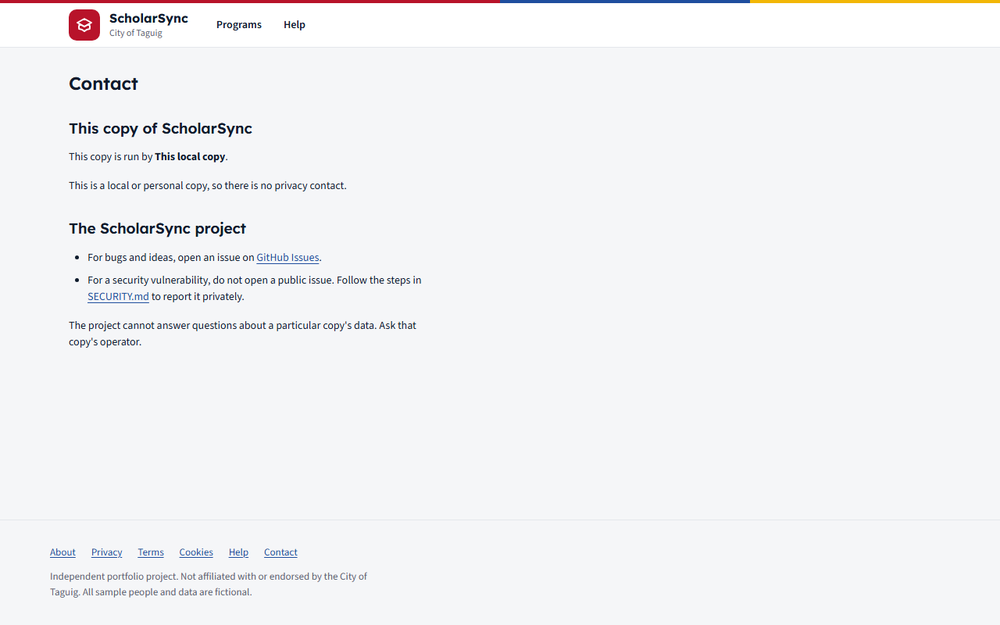

# Public pages

What anyone sees before signing in. [Back to all roles](../README.md)

## 1. Log in

The front door: going to `/` while signed out brings you here. In explore mode,
**Exploring ScholarSync? Use a test account** opens the list of demo accounts and fills one in.

## 2. Create an account

Students sign up themselves with their email, full name and a password, and agree to the privacy notice.
Staff accounts are made by the scholarship office instead.

## 3. Scholarship programs

Every open program, with a short description.

## 4. Program details

Who can apply, the allowance per semester for each tier (with and without merit), the application dates and the
documents a new applicant needs.

## 5. Help

Frequently asked questions about the site and the application process.

## 6. Contact

Who runs this copy, and where to report bugs or security problems in the project.

